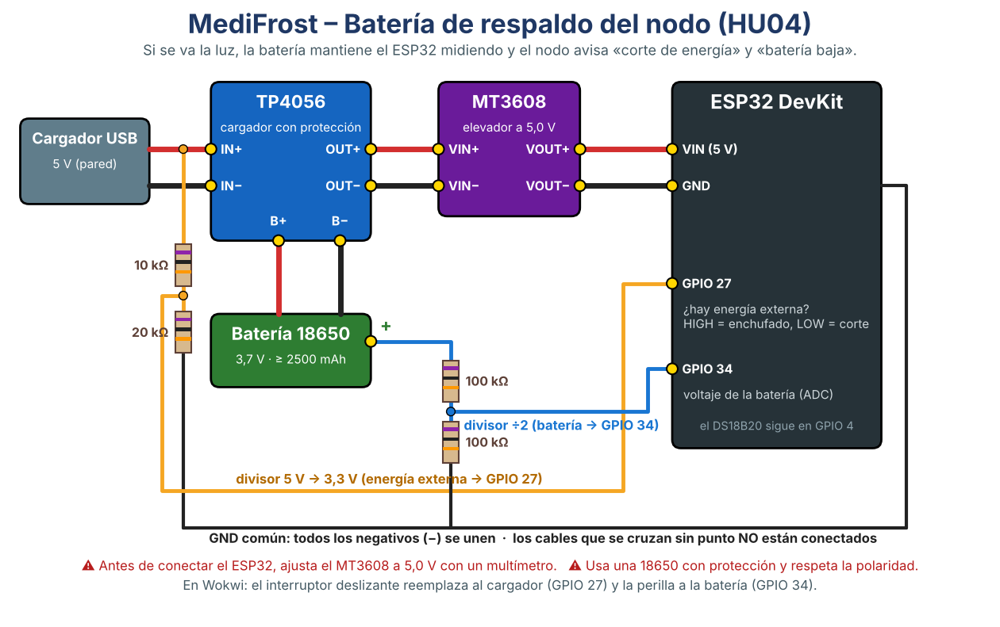

# MediFrost – Batería de respaldo del nodo (HU04 · MF-9)

**Tarea T26 – Ian Flores** (circuito) · T27 – Domenico Chang (firmware) · T28 – Kheyla Cóndor (pruebas)

Objetivo (criterios de HU04):

1. Sin energía externa, el nodo **sigue midiendo cada 60 s** durante al menos **12 h** (se valida con la prueba de autonomía).
2. Al perder la energía externa envía el evento **«corte de energía»**. Si la batería baja de **20 %**, envía **«batería baja»**.
3. En modo batería el WiFi se reintenta **cada 5 min** para ahorrar energía.



## Materiales

| Cant. | Componente | Para qué |
|---|---|---|
| 1 | Módulo **TP4056 con protección** (6 pines: IN+, IN−, B+, B−, OUT+, OUT−; el de USB-C o micro-USB) | Carga la batería cuando hay luz y la protege de sobredescarga |
| 1 | Batería **18650 Li-ion** de 2500 mAh o más, **con protección** | Respaldo durante el corte |
| 1 | Portapilas para 18650 | Conectar la batería sin soldarla |
| 1 | Módulo elevador **MT3608** | Sube los 3,7 V de la batería a 5 V para el pin VIN del ESP32 |
| 1 | Resistencia **10 kΩ** y 1 de **20 kΩ** (o 2 de 10 kΩ en serie) | Divisor que baja los 5 V del cargador a 3,3 V para el GPIO 27 |
| 2 | Resistencias **100 kΩ** | Divisor ÷2 para medir la batería en el GPIO 34 |
| — | Cables dupont y la protoboard del Sprint 1 | — |
| — | Multímetro | Ajustar el MT3608 y verificar los voltajes |

Los precios y las tiendas se confirman antes de comprar. Esta compra va en la tabla SAM (proveedores) del informe.

## Armado paso a paso

1. **Ajusta el MT3608 antes de conectar el ESP32.**
   1. Conecta la batería al TP4056 (B+ y B−) y su salida (OUT+ y OUT−) a la entrada del MT3608 (VIN+ y VIN−).
   2. Mide VOUT+ y VOUT− con el multímetro.
   3. Gira el tornillo del potenciómetro del MT3608 hasta leer **5,0 V**. Si giras al revés, el voltaje sube. **Con más de 5,5 V se puede dañar el ESP32.**
2. **Potencia:** conecta VOUT+ del MT3608 al pin **VIN** del ESP32 y VOUT− a **GND**.
3. **Cargador:** el cargador USB de pared va a la entrada del TP4056 (IN+ e IN−, o directo al conector USB del módulo).
   - El ESP32 ya **no** se alimenta por su propio USB; ese USB queda solo para cargar el programa desde la laptop.
4. **Detección de energía (GPIO 27):**
   1. Desde **IN+** (5 V del cargador) pon la resistencia de **10 kΩ**.
   2. Del otro extremo de esa resistencia sale un cable al **GPIO 27** y la resistencia de **20 kΩ** a **GND**.
   - Con el cargador enchufado, el GPIO 27 debe marcar unos **3,3 V**, y desenchufado, **0 V**.
5. **Medición de batería (GPIO 34):**
   1. Desde el **+ de la batería** (B+) pon una resistencia de **100 kΩ**.
   2. Del otro extremo sale un cable al **GPIO 34** y la otra resistencia de **100 kΩ** a **GND**.
   - Con la batería llena (4,2 V), el GPIO 34 marca unos **2,1 V**.
6. **GND común:** todos los negativos van unidos (TP4056, MT3608, ESP32 y los dos divisores).
7. El **DS18B20** se queda como en el Sprint 1 (GPIO 4, con su resistencia de 4,7 kΩ).

📸 Toma una foto del circuito armado y otra del multímetro en 5,0 V. Son la evidencia de T26.

## Activar en el firmware

En el `config.h` del nodo (copia de `config.example.h`) cambia:

```c
#define MEDIR_ENERGIA 1
```

Con `0`, que es el valor por defecto, el nodo funciona igual que en el Sprint 1 y no lee los pines 27 y 34. **No lo actives sin el circuito**: con el pin 27 al aire, el nodo detectaría cortes falsos.

## Verificación rápida

| Prueba | Qué hacer | Qué debe salir en el Monitor serie |
|---|---|---|
| Enchufado | Cargador conectado | Las lecturas llevan `"alimentacion":"externa"` |
| Corte | Desenchufar el cargador | `⚡ Evento: corte_energia (batería XX %)` y en Supabase una fila nueva en **evento_nodo**. Llega el correo «corte de energía» |
| Regreso | Volver a enchufar | `⚡ Evento: energia_restaurada` y el correo «volvió la energía» |
| Batería baja | Dejar el nodo en batería hasta < 20 % (o probarlo en Wokwi con la perilla) | `⚡ Evento: bateria_baja` y el correo «batería baja» |

## Prueba de autonomía de 12 h (aceptación de HU04)

1. Carga la batería al 100 %: el LED del TP4056 se pone azul o verde.
2. Desenchufa el cargador a una hora anotada, por ejemplo a las 20:00.
3. Deja el nodo midiendo toda la noche.
4. A las 12 h revisa en Supabase (tabla `lectura`) que haya **una fila por minuto sin huecos**, todas con `alimentacion = 'bateria'`. 📸
5. Anota el porcentaje de batería final.

**Estimación** (a validar con la prueba): con el WiFi encendido, el ESP32 consume en promedio unos 0,5–0,7 W. Una 18650 de 2500–3000 mAh guarda unos 9–11 Wh, así que con ~85 % de eficiencia del MT3608 alcanzaría unas **12–16 h**. Si no llega a 12 h, la mejora es usar el *light sleep* del ESP32 entre lecturas. Eso queda como riesgo en la matriz (RSK).

## Seguridad

- Usa siempre baterías **con protección** y respeta la polaridad (+ con +). Una 18650 en cortocircuito se calienta mucho.
- No dejes la batería cargando sin supervisión las primeras veces.
- Si el TP4056 o la batería se calientan demasiado como para tocarlos, desconecta todo.

## Sin hardware: Wokwi

`firmware/wokwi/diagram.json` ya trae un **interruptor deslizante** en el GPIO 27, que hace de energía externa, y una **perilla** en el GPIO 34, que hace de batería. Con `wokwi/config.example.h` (`MEDIR_ENERGIA 1`) se prueban el corte, el regreso y la batería baja sin comprar nada.
